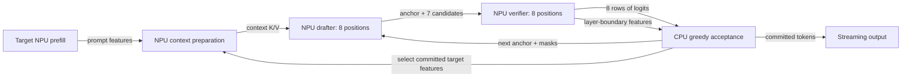

# Execution and mapping

This page follows a request and its state. The [code map](docs/code-map.md)
locates each implementation file; [From B1 to B8](docs/b8-megakernel.md) explains
the operator changes, storage and data-supply decisions behind the megakernel.

## One request

1. Tokenize with Qwen3's chat template and `enable_thinking=False`.
2. Prefill the target on the NPU. Capture target K/V, the first token, and the
   outputs of layers 2, 10, 18, 26 and 34.
3. Prepare the drafter's context from those committed target features.
4. Draft seven candidates alongside the current anchor in one B8 forward.
5. Verify the eight input positions in one target forward.
6. Commit the matching draft prefix and one target token. Repeat from step 3
   using only newly committed target features.

The target and drafter are distinct compiled programs sharing the same B8
mapping and C++ kernels. Their weights, layer counts, and attention visibility
differ. Context preparation is a third NPU program, dispatched before drafting.
These dispatches run sequentially on the same NPU.

## NPU and host responsibilities

| NPU | Host |
|---|---|
| Prefill projections and attention | Tokenization, embedding lookup and prefill final normalization |
| B8 RMSNorm, QKV/O/MLP projections, RoPE, attention and LM head | Instruction generation, XRT dispatch and data synchronization |
| Target-feature projection and hidden RMSNorm | Greedy acceptance and output streaming |
| Drafter context K/V projection, K normalization and RoPE | Committed position and context-KV upload |

Context preparation concatenates five tapped states into `[n, 12800]`, projects
them to `[n, 2560]`, normalizes, and projects to five pairs of K/V tensors. It
processes up to eight committed positions per invocation; the initial prompt
is chunked through the same program. Its BF16 weights remain resident.

## Weight lifetime during setup

Prefill is prepared before the decoder weight buffers are allocated. After the
upstream prefill warmup has uploaded each layer's gate, up and down matrices,
the host weight fields become read-only views of those same resident buffers.
Their sizes and all values are checked before sharing. This removes about 5 GiB
of duplicate arrays. The cache retains its per-layer buffers when it evicts a
hardware context, so subsequent prompts still use the same initialized weights.
The target and prefill also share their identical embedding matrix.
The shared Qwen3-4B loader converts the tied embedding/LM head to BF16 once
before loading layers, so initialization does not retain its FP32 expansion
or allocate a second BF16 copy for the head.

The prepass retains its device weight buffers and releases its temporary FP32
reference matrices after initialization. These setup changes preserve all
projection arithmetic, per-layer weight identities and decode timing boundaries.

## Selected B8 floorplan

The whole AIR graph is in [batch_graph.py](batch_graph.py), with the attention
subgraph in [fused_attention_graph.py](fused_attention_graph.py) and tile
arithmetic in [kernels/](kernels/). The [B1-to-B8 design guide](docs/b8-megakernel.md)
connects the following choices to formulas, buffer sizes and source functions.

The projection subsystem retains the B1 decoder's quantized weight stream.
Sixteen compute tiles in columns 0, 1, 6 and 7 perform thin B8 matrix products.
Each Q4 block is dequantized once and reused across eight rows. Weight buffers
ping-pong while scratch storage stays outside the inner reduction loop.

The residual owner retains the eight-row hidden state. A separate compute tile
holds normalized activations, preventing their repeated recomputation during
projection replay. Attention divides the eight query positions into four-row
shards, with separate query/K relays and fused QK/softmax/PV computation. Native
K layout and P/V operand reuse remove redundant layout and operand preparation.

The graph fixes its own memory-tile owners. They must not inherit B1 defaults:
B8's activation staging is in memory-tile column 4, while the main projection
gather is in column 2. SRAM capacity, six DMA channels per direction on each
memory tile, and packet/circuit compatibility all constrain this placement.

`batch_graph.py` states channels, buffers, owners, and transfer order.
`fused_attention_graph.py` states the attention shards and relay protocol.
Compiler output in each build directory retains allocation, lock, route, and
per-core ELF evidence for inspection.

## State and output contract

The committed KV length excludes the current anchor. A verifier call at
position `p` appends slots `p..p+7`. Target row `i` sees the committed context
and candidate rows `0..i`; drafter rows see the whole draft block. RoPE uses
`p+i`. Static capacity is 4096, while DMA/readback and attention work follow
the current KV length.

Rejected target slots may remain in the physical buffer. They are outside the
committed prefix, must be invisible, and are overwritten by later calls. The
drafter's newly committed context slots are replaced with K/V projected from
committed target features. Host acceptance never adds rejected features to the
next context-preparation call.

The target exports every row's vocabulary logits and retains layer boundaries;
the host reads the five boundaries needed for context preparation.
Logits are gathered as `[vocabulary chunk, token, within-chunk vocabulary]` and
converted to `[token, vocabulary]` on the host. Hidden states use
`[layer boundary, token, hidden]`. The KV ABI uses
`[layer, K groups then V groups, position, group width]`.

## Validation boundaries

- Host checks cover acceptance, bonus token, token budget, EOS, and streaming.
- Decoder checks reset identical inputs/state and require exact repeats; they
  check causal/bidirectional visibility and untouched prefix/tail regions.
- The complete loop is compared with a sequential oracle using the same B8
  arithmetic, including each round's acceptance and committed KV.
- Attention is compared elementwise with FP32 SDPA converted to BF16.
- The upstream top-5 output-token comparison supplies a separate full-model
  check against the original BF16 target.

Build success and historical benchmark results do not replace these checks
when source, compiler or dependency versions change.
