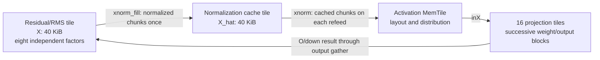
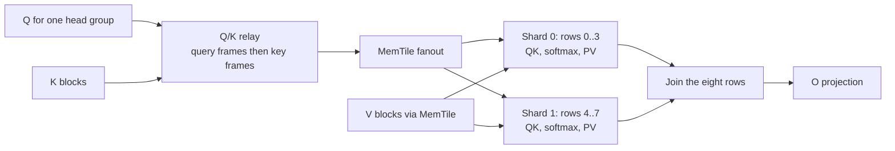

# From single-token decode to the B8 megakernel

The B8 design preserves the single-token decoder's stream of quantized weights
and reuses each weight block across eight positions. It expands the activations,
adds per-position attention visibility and RoPE, and changes on-chip storage and
data supply to support the larger working set.

The implementation has two parts: [batch_graph.py](../batch_graph.py) describes
the complete AIR dataflow, and [kernels/](../../common/kernels) contains the operations
executed on each compute tile. [fused_attention_graph.py](../../common/fused_attention_graph.py)
defines the attention subgraph. Use the [code map](code-map.md) to follow the
build and runtime entry points.

## Relationship to B1

The existing B1 implementation is
[fused_decode.py](../../../../fused_decode/fused_decode.py), used by the
[Qwen3-4B Q4NX driver](../../../qwen3_4b_q4nx/qwen3_4b_q4nx_inference.py).
Its spatial pipeline streams projection weights through sixteen compute tiles
and connects them to normalization/residual, RoPE, attention and MLP stages.
The same projection subsystem also computes the LM head in vocabulary chunks.

For B8, `target_config.load_geometry()` imports that module's Qwen3-4B geometry
and helpers. `load_layout()` adds B8 types, placement and transfer choices;
`build_module()` then calls this example's own `batch_graph.build_module()`.
The selected B8 graph is a concrete multi-token mapping with shared B1 geometry
and arithmetic helpers.

Here, **B is the number of consecutive positions in one request**, not the
number of independent requests. The target processes an anchor and seven draft
candidates. The drafter processes an anchor and seven mask positions. Their
separate programs share the B8 builder, with 36/5 layers and causal/bidirectional
attention respectively. Context preparation is a third NPU program; its
implementation is described in [ARCHITECTURE.md](../ARCHITECTURE.md).

## What changes at the operator level

Let `p` be the committed KV cache length before a call, excluding its anchor.
For Qwen3-4B, hidden width `d = 2560`, FFN width `d_ff = 9728`, query width
`d_q = 4096` (32 heads), KV width `d_kv = 1024` (8 heads), and head width
`d_h = 128`. Query width and model hidden width are different in this model.

| Operation | B1 | B8 requirement |
|---|---|---|
| Embedding lookup | One row `[d]` | Eight rows `[8,d]`; the host looks up all input embeddings. |
| RMSNorm | One reduction over `d` | Eight independent reductions and factors, each over `d`. |
| QKV projection | GEMV, output width `d_q + 2*d_kv = 6144` | Thin GEMM, output `[8,6144]`, with the same weights. |
| Q/K normalization and RoPE | Heads at position `p` | Apply head normalization independently and rotate row `i` at `p+i`. |
| KV append | Write one slot | Write slots `p` through `p+7`; allocated cache capacity stays fixed. |
| Attention | One query per head | Eight queries per head with independent softmax state and row-specific visibility. |
| O projection | `d_q → d` | Same weight matrix, eight input/output rows. |
| Residual, gate/up, SiLU, multiply, down | One hidden/FFN row | Eight independent rows; gate/up is `d → 2*d_ff`, down is `d_ff → d`. |
| LM head | One distribution over the vocabulary | Eight distributions for verification and the target's next-token choice. |
| Hidden-state output | Ordinary layer chaining | Retain layer boundaries so the host can read the target features needed by the drafter. |

For a projection with `W` shaped `[n,k]`, the change is

$$
y_n = \sum_j W_{nj}x_j
\quad\longrightarrow\quad
Y_{in} = \sum_j X_{ij}W_{nj},\qquad i=0,\ldots,7.
$$

The weight matrix keeps its shape; each weight contributes to eight rows.
Weight reuse creates the performance opportunity. Matrix compute, activation
traffic, attention work and synchronization determine how much of that
opportunity the NPU mapping realizes.

## Projection: retain the weight stream, change its consumers

`batch_graph.py` retains the sixteen projection tiles in columns 0, 1, 6 and 7.
Search for `_core_blk`, its `_mm()` loop, and the `proj_blk` herds. Each tile
receives the same kind of group-32 affine Q4 weight block as B1. It unpacks one
block to a BF16 scratch buffer and uses it for all eight token rows before
advancing the weight stream.

The active call chain is:

```text
batch_graph: _mm()
  -> proj_qmm_mm_zero()
  -> proj_qmm_mm_acc() for each reduction block
       -> q4k_unpack_block()
       -> q4k_mmul_small<..., 8>()
  -> proj_qmm_mm_flush_token() for each output token
```

The C++ functions are in [proj_batch.cc](../../common/kernels/proj_batch.cc) and
[q4k_batch.h](../../common/kernels/q4k_batch.h). The matrix primitive is
`aie::mmul<8,8,8>`: each invocation covers eight token rows, eight reduction
elements and eight output channels. Four accumulators cover 32 output channels
while reusing a loaded activation operand. The build enables the standard
BF16-to-BFP16 matrix path and retains FP32 accumulators.

This also requires new layouts. The microkernel receives activations as
`[K/8, token, 8]` and unpacked weights as `[output/8, K/8, 8, 8]`; its accumulator
is `[output/8, token, 8]`. `target_config.load_layout()` and the AIR channel
offsets/strides connect these layouts to the rest of the graph. The selected
output path drains one token per short packet while the GEMM accumulator stays
resident. It avoids multiplying every packet buffer by eight.

Weight ping-pong overlaps transfer and computation. `_wscr_alloc()` keeps
dequantization scratch outside the inner reduction loop using
`air.disable_alloc_sink`; the accompanying compiler fix preserves this lifetime
so the scratch allocation does not obstruct the weight-buffer transformation.

## RMSNorm: give normalized activations their own owner

The B1 residual/normalization tile can retain several model-width vectors.
Multiplying all of those allocations by eight exceeds its 64 KiB L1 budget:

| BF16 storage | B1 | B8 |
|---|---:|---:|
| Hidden/residual `X` | 5 KiB | 40 KiB |
| Normalized activation `X_hat` | 5 KiB | 40 KiB |
| These two tensors together | 10 KiB | 80 KiB |

That total precedes norm weights, staging buffers and the stack. For each row,
normalization has two parts:

$$
a_i = \left(\frac{1}{d}\sum_{j=0}^{d-1}X_{ij}^{2}+\epsilon\right)^{-1/2},
\qquad
\widehat X_{ij} = (X_{ij}w_j)a_i.
$$

A capacity-saving B8 route retains `X` and the eight factors `a_i`, then
regenerates chunks of `X_hat` whenever projection requests the activation again.
These repeated reads occur because different output-channel blocks consume the
same normalized input. The repeated work is the elementwise production of the
normalized chunks; the row reductions can remain outside that refeed loop.

The selected design computes each normalized chunk once per normalization
stage and transfers it to a separate cache tile. That tile owns the full 40 KiB
normalized slab and replays chunks to projection. After the attention residual
update, the next normalization stage replaces the slab with the new values.



Source anchors in [batch_graph.py](../batch_graph.py):

- `_rms_batched_norm()` computes each row factor and produces chunks through
  `rms_chunk_aie()` in [rms_batch.cc](../../common/kernels/rms_batch.cc). Its selected callers
  request one production pass per normalization stage.
- The `rms` herd keeps the residual and applies O/down updates row by row.
- The `norm_cache` herd receives `xnorm_fill`, then replays the slab according
  to `REFEED` or `VOCAB_RNDS`. Its
  [normalized_cache_chunk()](../../common/kernels/norm_cache.cc) helper copies 4096 BF16
  values per chunk; five chunks cover the eight rows of width 2560.

Thus normalization arithmetic stays with residual ownership, while storage and
repeated supply of its result move to the cache tile. This removes repeated
chunk arithmetic while keeping both owners within their L1 constraints.

## Attention: expose query parallelism and supply the shards

For one head, let `K` and `V` include the committed prefix and this call's eight
new positions. Target row `i` must see keys `0..p+i`:

$$
S_{ij}=\frac{Q_i K_j^T}{\sqrt{d_h}}+\mathcal{M}_{ij},
\qquad P_i=\operatorname{softmax}(S_i),\qquad O_i=P_iV,
$$

where `M_ij = 0` for `j <= p+i` and is negative infinity otherwise. All cached
prefix keys are visible to every row; visibility differs within the new block.
The drafter allows every row to see the entire block through `p+7`. Each
query/head has its own running maximum, denominator and output accumulator.

A direct extension can loop over all eight queries on the original attention
cores. It performs the required math, but serializes independent query work.
The selected graph partitions both the existing head groups and the token axis:
four head groups each have two compute shards, processing rows `0..3` and
`4..7`. This gives eight attention compute tiles. Within a shard, paired-query
QK/PV routines combine two token queries and four query heads sharing one KV
head into eight matrix rows. Projection's eight matrix rows represent eight
tokens; attention's eight matrix rows represent this query/head combination.
The two row shards execute on separate cores; each shard still streams key
blocks in order and performs its online-softmax updates.



The figure shows one head group. The full graph has two Q/K relay cores, each
serving two head groups. Relays reshape/split query frames and forward key
frames through a shared path to the MemTile fanout. This organizes input supply
within the available tile DMA and routing resources. V uses its own channels.
`ParallelAttentionGraph.emit()` defines the relay, MemTile rings and shards;
`query()` and `gather()` connect this subsystem to the decoder graph.

Two further changes reduce work inside this mapping:

- **Native K layout and early release.** `dflash_qk_pair_raw()` in
  [attn_pair_qk.h](../../common/kernels/attn_pair_qk.h) consumes K using BFP operands and
  the matrix transpose modifier. The selected path avoids materializing the
  BF16 8-by-8 transpose. In the graph, the K last-use region ends before the
  shard acquires V, allowing the K input buffer to be reused earlier.
- **P/V operand reuse.** For a fully visible key block,
  [dflash_pv_reuse_v()](../../common/kernels/attn_reuse_pv.h) prepares probabilities for
  two query pairs outside the head-dimension loop and shares each loaded V
  operand between the pairs. It preserves the separate FP32 rescale and add.

At a partial causal boundary, different queries need different valid V values.
BFP shares exponents across groups of eight reduction elements, so a masked
future V could otherwise affect conversion of a visible value. The wrapper in
[attn_kv_batch.cc](../../common/kernels/attn_kv_batch.cc) clears invalid V elements before
conversion and processes queries from the least to the most restrictive mask.
Fully visible blocks take the shared-operand path; boundary blocks retain this
per-query handling. The visibility tests exercise this distinction.

## Positions, KV length and output are part of the kernel contract

`TargetDecoder.verify(tokens, position)` receives `position = p`. The host
generates RoPE LUT rows for `p+i` and passes the runtime scalar `L = p+1` to
the transaction builder and graph. The selected attention/readback work visits
`ceil((p+8)/16)` key blocks, with visibility still checked per query. Capacity
4096 defines allocation and bounds; the current KV length defines executed
attention work. The relevant sources are [target_runtime.py](../target_runtime.py),
[decode_dynseq.py](../decode_dynseq.py) and `_live_rounds()` in the main graph.

The graph writes all eight new KV slots before verification completes. Host
acceptance advances the committed prefix by the number of emitted tokens.
Rejected slots remain outside that prefix and are overwritten by subsequent
calls. Drafter context slots are replaced by K/V projected from committed
target features through `append_context_kv()`.

The LM head exports every row, with device layout
`[vocabulary chunk, token, within-chunk vocabulary]`. The host gathers it into
`[8, vocabulary]`. Layer outputs are retained in the hidden buffer as
`[layer boundary, token, hidden]`; `hidden(tap_slots)` reads the five boundaries
needed for context preparation. The DFlash loop selects only committed rows
from those features. These interfaces support the complete speculative loop
on top of the multi-token decoder.

## Hardware constraints and their source-level decisions

| Constraint | Selected design | Where to inspect |
|---|---|---|
| 64 KiB L1 per compute tile | Separate residual and normalized-slab ownership; bounded chunks for replay and output. | `rms`, `norm_cache`, `rmsb_l1`, `rstg_l1` in `batch_graph.py`. |
| Weight/activation buffers and scratch need overlapping lifetimes | Preserve scratch/activation allocations outside reduction loops and pipeline weight transfer. | `_wscr_alloc()`, `_core_blk()`, `air.disable_alloc_sink`. |
| MemTile capacity, six DMA channels per direction and packet/circuit routing compatibility | Explicit B8 placement: activation staging in column 4, main projection gather in column 2; distribute attention rings separately. | `target_config.load_layout()`, `air.memtile_col`, and `air.memtile_dma_channel_min` annotations. |
| DMA-owned storage must remain valid until consumption ends | Shared channel locks protect producer reuse; early K release exposes its actual last use; MemTile forwarding preserves its L2 owner. | Channel declarations, `ParallelAttentionGraph.emit()`, and the [compiler fixes](compatibility.md). |
| Shard outputs must join without borrowing live input storage | Reuse the dead score slab for the cascade output join. | `dflash_join_send()` / `dflash_join_receive()` in `attn_fused_batch.cc`. |

The AIR compiler allocates buffers and locks and routes the declared channels.
Build directories retain `compile_L*/input.mlir`, lowered intermediates and
per-core ELF files for inspecting how these declarations were implemented.
[build_target.py](../build_target.py) records the compiler options, source and
artifact hashes in each manifest; [compatibility.md](compatibility.md) lists
the required AIR fixes.

## How to review the transformation

Read `load_geometry()` / `load_layout()` beside the Qwen3-4B entry in B1's
`fused_decode.py`, then follow projection, residual/cache and attention through
the source anchors above. The code in this example expresses the selected final
mapping. The operator requirements explain the functional B1-to-B8 extension;
the ownership and data-supply decisions explain its optimized implementation.

[Validation](validation.md) records full-output attention/prepass checks,
decoder repeatability and visibility, the matching-arithmetic sequential oracle,
committed-KV checks and model comparison. The measured Full20/Full80 studies
include prepass, draft, verification and host work. They connect kernel design
to complete-loop performance under an explicit workload and timing boundary.
