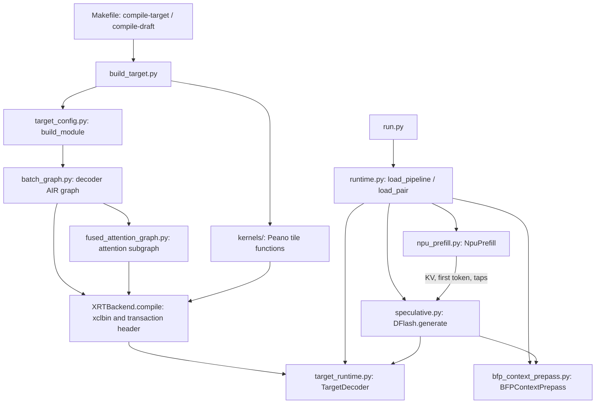

# Code map

The B8 megakernel is implemented by an AIR graph and the C++ functions called
on its compute tiles. Start with [batch_graph.py](../batch_graph.py) for the
whole decoder and [fused_attention_graph.py](../fused_attention_graph.py) for
its attention subsystem. [B1 to B8](b8-megakernel.md) explains their design.
The host's draft/verify/commit loop is in [speculative.py](../speculative.py).

All paths below are relative to the Qwen3-4B example unless stated otherwise.
The supported configuration is selected by `selected_config()` and the flags
in `build_target.py`. This example contains the selected B8 path; historical
mapping experiments are outside its source tree.

## Follow a build or request

`build_target.py` builds both roles. Target and drafter have separate artifacts
and weights, with the same graph implementation. The separate context-prepass
program is built by `build_bfp_prepass.py`. For a normal request, target prefill
runs once; each speculative round then runs context preparation, drafting and
verification. [ARCHITECTURE.md](../ARCHITECTURE.md) describes that state flow.

## Entry points and host execution

| File | Responsibility and useful entry points |
|---|---|
| [Makefile](../Makefile) | User commands, artifact locations, cache variables and exclusive NPU session lock. |
| [run.py](../run.py) | CLI for a single prompt or resident interactive session; initializes the pipeline and streams committed output. |
| [runtime.py](../runtime.py) | `load_pair()` constructs target, drafter and NPU prepass; `load_pipeline()` also prepares NPU prefill and shares weights. Includes CPU-prefill helpers for the explicit CPU path. |
| [speculative.py](../speculative.py) | `DFlash.reset()` / `generate()`, greedy acceptance, token budget/EOS, committed positions, target-feature selection, round traces and decode timing. `autoregressive()` is the benchmark's B1 loop. |
| [target_runtime.py](../target_runtime.py) | `TargetDecoder` loads either role's artifacts/weights, owns XRT buffers, runs B8 `verify()`, returns all logits, reads hidden boundaries and seeds/appends/restores KV. The method name `verify()` is also used for the drafter forward. |
| [decode_dynseq.py](../decode_dynseq.py) | `DynseqInstsGen` uses the compiler-generated transaction builder to construct instructions for the current KV length. |
| [streaming.py](../streaming.py) | Converts newly committed token IDs into incremental text while retaining incomplete tokenizer fragments. |
| [npu_prefill.py](../npu_prefill.py) | `NpuPrefill` reuses the existing Qwen3-4B Q4NX NPU prefill and captures the hidden boundaries needed by DFlash. It shares uploaded MLP weights before LM-head initialization to reduce peak host memory. |
| [prefill_reference.py](../prefill_reference.py) | CPU prompt forward with hidden taps, used by the CPU-prefill path. |

## B8 graph and build configuration

| File | Responsibility and useful entry points |
|---|---|
| [selected_config.py](../selected_config.py) | Fixes B8, capacity 4096, 36 target / 5 drafter layers and role-specific visibility; rejects runtime artifacts from a different mapping. |
| [target_config.py](../target_config.py) | `TargetConfig`, `load_geometry()`, `load_layout()` and `abi()`. Imports shared B1 geometry, declares B8 buffer/layout choices, and calls the B8 graph builder. |
| [batch_graph.py](../batch_graph.py) | `build_module()` constructs the complete AIR graph: weight streams, activation and output layouts, KV append/readback, projection herds, RoPE, MLP, residual/RMS and normalized-activation cache. Search for `_core_blk`, `_rms_batched_norm`, `norm_cache` and `parallel_attention`. |
| [fused_attention_graph.py](../fused_attention_graph.py) | `ParallelAttentionGraph.query()`, `emit()` and `gather()` connect Q/K relays, K/V distribution, eight four-query/head shards and their output join. |
| [build_target.py](../build_target.py) | Compiles tile functions with Peano, builds the AIR module, calls `XRTBackend.compile()`, and saves the xclbin, transaction header, source snapshot and manifest. Supports checked reuse of target objects for drafter compilation. |
| [build_identity.py](../build_identity.py) | Fingerprints build inputs and rejects an existing artifact directory when compiler, dependency or relevant source identities differ. |

## C++ compute-tile functions

These files are linked into the AIR graph. Their invocations, buffer lifetimes
and placement are controlled by the Python builders above.

| File | Responsibility in the selected B8 path |
|---|---|
| [kernels/proj_batch.cc](../kernels/proj_batch.cc) | Projection accumulator initialization, weight unpack + thin GEMM, and per-token packet output. Calls `q4k_mmul_small<..., 8>()`. |
| [kernels/q4k_batch.h](../kernels/q4k_batch.h) | Q4 unpacking into matrix layout and the B8 `aie::mmul<8,8,8>` microkernel with four output accumulators. |
| [kernels/rms_batch.cc](../kernels/rms_batch.cc) | `rms_scale_row_aie()`, `rms_chunk_aie()` and `residual_acc_row_aie()` implement independent row factors, normalized chunks and residual updates. |
| [kernels/norm_cache.cc](../kernels/norm_cache.cc) | `normalized_cache_chunk()` copies cached B8 normalized chunks bit-for-bit for projection refeed. The AIR `norm_cache` herd owns the full cached slab. |
| [kernels/glu_batch.cc](../kernels/glu_batch.cc) | Row-wise gate/up activation and elementwise combination for the MLP. |
| [kernels/attn_fused_batch.cc](../kernels/attn_fused_batch.cc) | Translation unit combining QK/PV wrappers, Q/K relay copies and output-join helpers. Provides `dflash_fused_qk()` and `dflash_fused_pv()`; compiled to LLVM IR for merging into shard cores. |
| [kernels/attn_qk_batch.cc](../kernels/attn_qk_batch.cc) | Batched QK entry points; dispatches the selected tile operation to the paired-query implementation. |
| [kernels/attn_pair_qk.h](../kernels/attn_pair_qk.h) | Pairs two queries for matrix arithmetic, consumes native-layout K, and updates each query/head's masked online-softmax state. |
| [kernels/attn_kv_batch.cc](../kernels/attn_kv_batch.cc) | PV entry points and final normalization; handles partially visible key blocks with per-query V masking before BFP conversion. |
| [kernels/attn_pair_pv.h](../kernels/attn_pair_pv.h) | Checks the query/head geometry and calls `dflash_pv_reuse_v()` for a fully visible key block. |
| [kernels/attn_reuse_pv.h](../kernels/attn_reuse_pv.h) | Prepares probabilities for two query pairs and lets both pairs consume each V operand, preserving separate FP32 rescaling and addition. |

RoPE reuses [fused_decode/kernels/rope.cc](../../../../fused_decode/kernels/rope.cc).
Several wrappers also include shared projection, RMS, GLU and attention code
from that directory. The `link_with` attributes in the AIR graph identify the
compiled object/LLVM IR used by each herd or function.

## NPU context preparation and arithmetic references

| File | Responsibility |
|---|---|
| [build_bfp_prepass.py](../build_bfp_prepass.py) | Builds the standalone NPU program for target-feature projection, hidden normalization, drafter K/V projection and key normalization/RoPE. |
| [bfp_context_prepass.py](../bfp_context_prepass.py) | `BFPContextPrepass` loads the ELF, packs BF16 matrices and uploads resident weights. `BF16ContextReference` supplies the CPU reference and checkpoint tensors. |
| [npu_context_prepass.py](../npu_context_prepass.py) | Shared host dispatch/buffer handling: `chunk()` processes up to eight committed positions, and `run()` chunks longer prompt features. |
| [context_prepass.py](../context_prepass.py) | CPU RMSNorm/RoPE and context-K/V reference operations. |
| [kernels/context_prepass_bfp.cc](../kernels/context_prepass_bfp.cc) | BF16/BFP projection microkernel, FP32 partial sums, output layout conversion and hidden normalization. Includes the key helpers below. |
| [kernels/context_prepass.cc](../kernels/context_prepass.cc) | Key-head normalization and RoPE functions for the standalone prepass. |

## Checkpoints and weight preparation

| File | Responsibility |
|---|---|
| [model_paths.py](../model_paths.py) | Exact target/tokenizer/drafter revisions, cache defaults and tokenizer loading. |
| [resources.py](../resources.py) | Online preparation or offline completeness checks for the pinned HF snapshots. |
| [draft_weights.py](../draft_weights.py) | `DraftWeights` adapts official drafter tensors, layer geometry, target tap slots and mask-token metadata to the decoder interface. |
| [prepare_weights.py](../prepare_weights.py) | Validates or creates persistent target/drafter packed caches and their preparation manifest. |
| [target_packing.py](../target_packing.py) | Reproduces the selected target's Q4NX → BF16 dequantization → group-32 Q4 repacking. See [compatibility](compatibility.md) for its distinction from upstream raw-Q4 packing. |
| [weight_io.py](../weight_io.py) | Uploads the packed weight payload with bounded host-memory use. |
| [requirements.txt](../requirements.txt) | Python dependencies added to the standard AIR environment. |

## Benchmarks and validation

| File | Responsibility |
|---|---|
| [benchmark/cases.json](../benchmark/cases.json), [benchmark/download.json](../benchmark/download.json) | Readable frozen prompts/token IDs/source indices and the downloadable bundle's checksum. |
| [benchmark_data.py](../benchmark_data.py), [prepare_inputs.py](../prepare_inputs.py) | Fetch/check the frozen bundle and load a prompt's saved prefill with token-identity checks. |
| [benchmark.py](../benchmark.py) | Runs one engine on the selected cases; records tokens, acceptance traces and timings; updates per-dataset and pooled summaries. |
| [paired_benchmark.py](../paired_benchmark.py) | Runs B1 and DFlash in separate processes, selects 4 or 16 fixed cases per dataset, validates paired identities and reports Full20/Full80 speedup. |
| [baseline.py](../baseline.py), [build_baseline.py](../build_baseline.py) | Adapt and build the existing single-token `FusedDecoder` for a fresh B1 control with the same target cache and inputs. |
| [profile_dflash.py](../profile_dflash.py) | Standard short-prompt NPU-prefill/decode profile and upstream `.perf.json` output. |
| [provenance.py](../provenance.py) | Records runtime/shared-source hashes and model revisions alongside measurements. |
| [verify_loop.py](../verify_loop.py) | Host acceptance tests and repeated NPU-prefill DFlash/oracle/committed-KV verification. |
| [tests/check_decoder.py](../tests/check_decoder.py) | Decoder repeatability, visibility, context injection and untouched KV regions at selected lengths. |
| [tests/check_loop.py](../tests/check_loop.py) | Saved-prefill DFlash versus a sequential oracle with matching B8 arithmetic, including per-round committed state. |
| [tests/check_model.py](../tests/check_model.py) | Separate NPU/HF token captures and upstream-style mutual top-5 comparison at first divergence. |
| [tests/check_attention.py](../tests/check_attention.py) | Production-linked attention output/reference checks, row isolation, visibility and repeatability. |
| [tests/check_prepass.py](../tests/check_prepass.py), [tests/bfp_reference.py](../tests/bfp_reference.py) | Prepass full-output/repeat/chunk tests and its matching BFP arithmetic helper. |
| [tests/checks.py](../tests/checks.py), [test_streaming.py](../test_streaming.py) | Test report/hash helpers and incremental-text tests. |
| [run_npu2_compile.lit](../run_npu2_compile.lit), [run_npu2_verify.lit](../run_npu2_verify.lit), [run_npu2_profile.lit](../run_npu2_profile.lit) | Upstream compile, correctness and short-profile suite entries. |
| [run_npu2_full20.lit](../run_npu2_full20.lit), [run_npu2_full80.lit](../run_npu2_full80.lit) | Default nightly paired Full20 and explicitly enabled Full80. |

See [validation](validation.md) for numerical gates and executed coverage, and
[CI](ci.md) for runner setup, suite selection, persistent caches and time budgets.

## Shared upstream integration

The B1 graph is [fused_decode.py](../../../../fused_decode/fused_decode.py);
its existing Qwen3-4B driver is
[qwen3_4b_q4nx_inference.py](../../../qwen3_4b_q4nx/qwen3_4b_q4nx_inference.py).
NPU prefill reuses the Qwen3-4B Q4NX prefill and shared LLM infrastructure.

Outside this example, the PR updates the LLM weight list/download workflow,
CMake/LIT suite discovery, nested model-result association and nightly result
collection. The three AIR compiler fixes and two shared kernel/loader changes
are described with their regression tests in [compatibility](compatibility.md).
